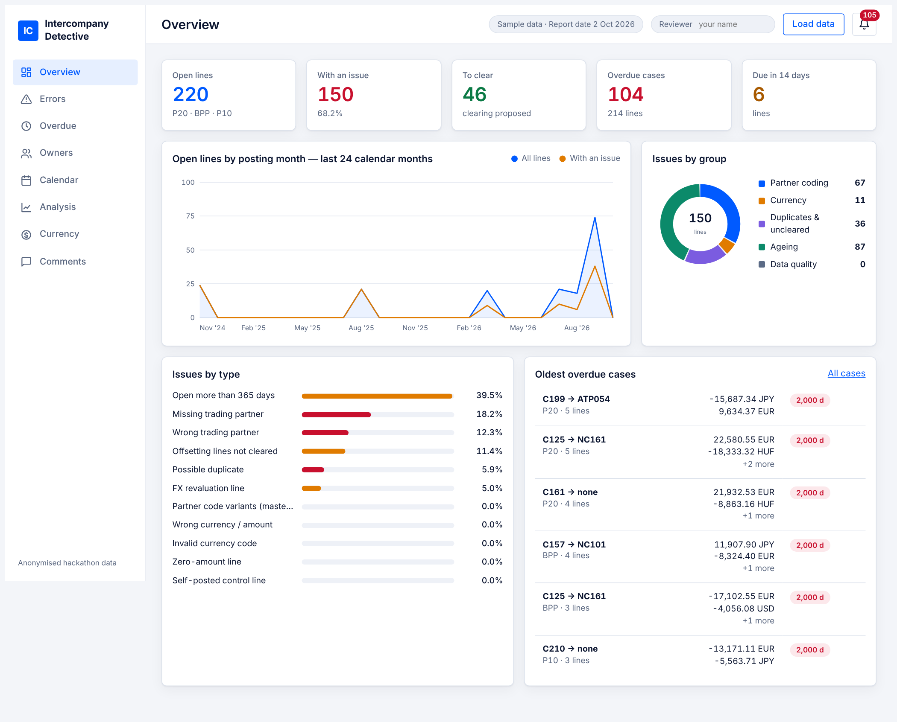
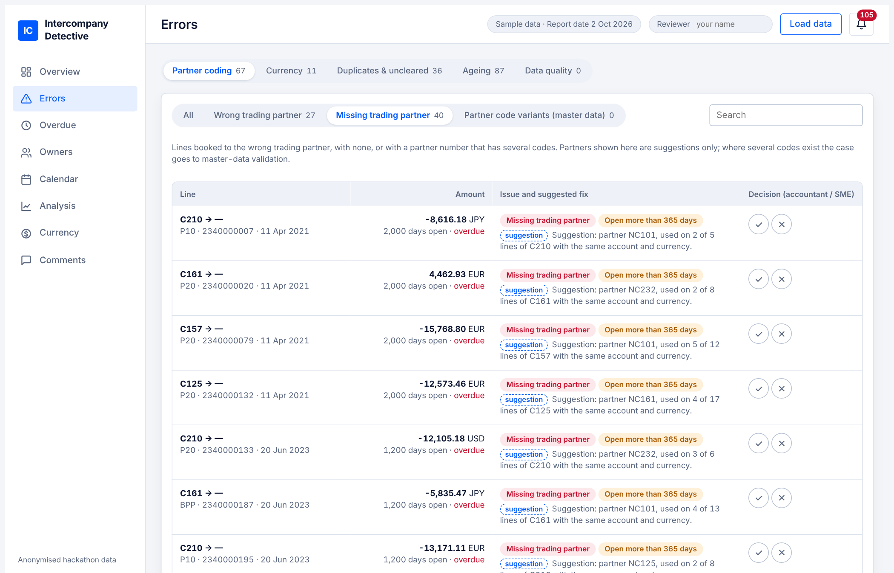
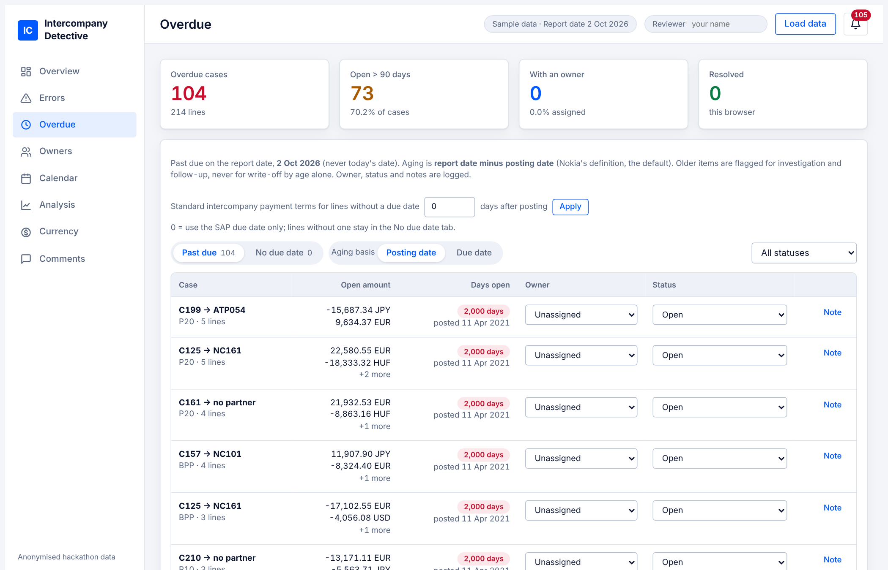
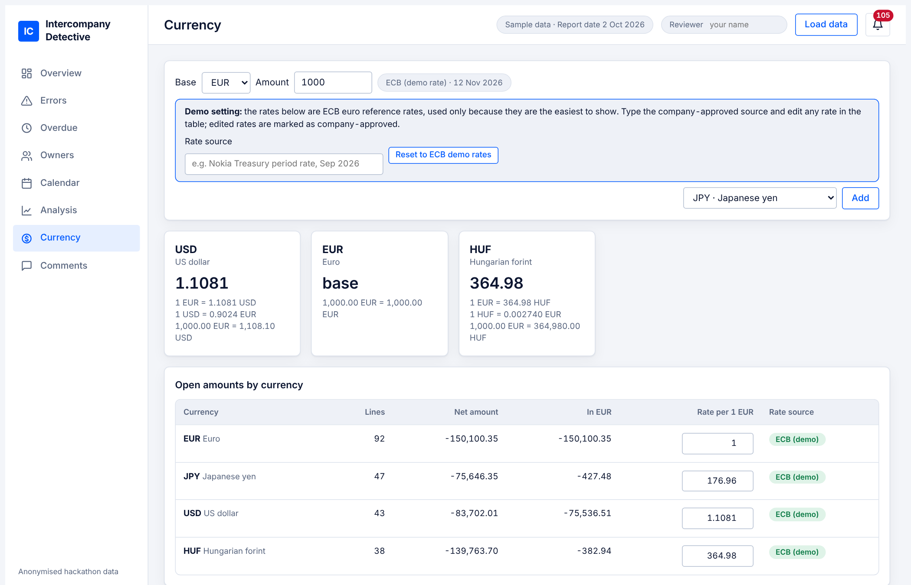

# Intercompany Detective

A single-page demo for the Nokia Finance Hackathon. It scans open intercompany lines from three ERPs (P20, BPP, P10), groups the problems and suggests a fix for each, so accountants review a short list of cases instead of thousands of rows.

It is **decision support only**: the accountant or SME validates every suggestion, and the tool keeps an audit trail. Nothing is posted to SAP.



## Features

| Tab | What it does |
|---|---|
| Overview | KPI cards, open lines by posting month (24 calendar months), issues by group and type, oldest overdue cases |
| Errors | Five error groups; each line has a suggested fix you accept or reject |
| Overdue | Past-due lines grouped into cases with owner, status and note; aging basis toggle; optional standard payment terms |
| Owners | Manage the names available for overdue-case assignments |
| Calendar | Due dates in red (overdue), amber (within 14 days) and green, plus a bell for alerts |
| Analysis | Error shares, review progress, decision log (audit trail), recommendations, CSV exports and a PDF report |
| Currency | Exchange rates (ECB demo rates by default), editable company-approved rates and source, open amounts by currency |
| Comments | Weak line texts with a suggested standard comment |



## Rules

Ten rules across five groups: wrong or missing trading partner, wrong or invalid currency, FX revaluation line, possible duplicate, offsetting lines not cleared, open more than 365 days, zero-amount line and self-posted control line. One more flag is advisory and not counted as an issue line: **partner code variants**, where one partner number appears under several codes (for example NC161 and TP-161).

## How the tool treats cases (agreed with Nokia Finance)

- **Aging** is report date minus **posting date**, never today's date. Overdue means past the due date on the report date. The Overdue tab can switch the aging basis to due date.
- **Payment terms.** Due dates come from SAP as exported. For lines without one, enter the standard intercompany payment terms (days after posting) in the Overdue tab; at 0 they are listed separately.
- **No materiality threshold.** Small differences are never hidden.
- **Missing trading partner.** The tool shows a suggested partner (same company, account and currency); the accountant or SME decides.
- **Several partner codes** for one partner number are flagged for master-data validation and never recoded automatically.
- **Old open items** are flagged separately for investigation. The tool never suggests a write-off because of age alone.
- **Exchange rates.** The demo uses ECB euro reference rates because they are the easiest to show. In the Currency tab, type the company-approved source and edit any rate; edited rates are marked as company-approved.
- **Control.** Accept and reject decisions, owner, status, note and rate changes go into a timestamped decision log (Analysis) with the reviewer name. The log can be exported as CSV.





## Run it

No install needed. Open the built file in a browser:

```bash
python3 build.py
# then open dist/Intercompany_Detective.html (double-click it)
```

This builds one self-contained HTML file with the synthetic sample data from `data/sample.json`.

### With the real hackathon data

The hackathon data is confidential, so it is not in this repo. Put your own file at `data/data.json` (same JSON format as `data/sample.json`: `report_date`, `fields` and `rows`); git ignores it, as it does `dist/`. Then run `python3 build.py` again, or pass a path: `python3 build.py path/to/data.json`.

You can also open any build and click **Load data** to try a `data.json` for the current browser session.

## Project layout

```
src/index.html        page markup (the tabs and layout)
src/styles.css        design system and all styling
src/app.js            all app logic, charts and PDF report
vendor/               jsPDF, used for the PDF report
data/sample.json      synthetic sample data
build.py              builds dist/Intercompany_Detective.html
docs/                 screenshots (built from the synthetic sample data)
```

## Editing

Change `src/index.html`, `src/styles.css` or `src/app.js`, run `python3 build.py`, and reload `dist/Intercompany_Detective.html`. The build inlines everything into one file you can share.

## Notes

- Decisions, owner names, assignments, statuses, notes, the decision log and rate edits are stored in your browser only.
- Demo currency rates are ECB euro reference rates from 12 Nov 2026.
- The AI buttons and the ECB refresh only work when the page runs inside Claude as an artifact. In a plain browser they are hidden.
- The design follows the public look of nokia.com (blue `#005AFF`, 4px base unit). It uses no Nokia logo or assets.
